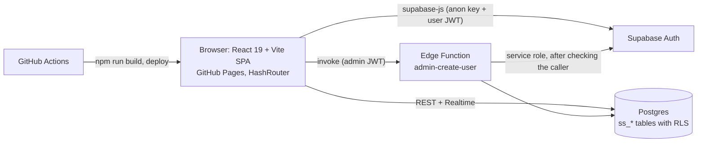
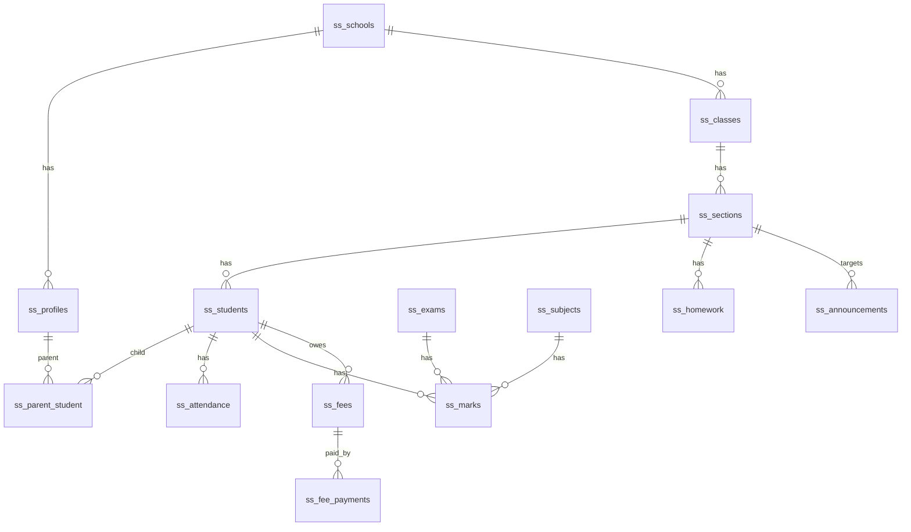

# SchoolSync

A school management system that keeps staff work to a minimum: attendance, marks and report cards, fees with receipts,
announcements, homework, and a UDISE+ readiness report with Excel export. Built solo as a portfolio project.

**Live demo:** https://anil0525.github.io/schoolsync (use the demo buttons on the login page, no sign-up needed)

## Screenshots

| Login | Admin dashboard |
| --- | --- |
|  |  |

| Attendance | Report card PDF |
| --- | --- |
|  |  |

| Fees (admin) | Fees (parent) |
| --- | --- |
|  |  |

| UDISE+ readiness | Telugu UI |
| --- | --- |
|  |  |

## Demo accounts

Password for all demo accounts: `Demo@2026`

| Role | Email |
| --- | --- |
| Admin (principal) | admin@schoolsync-demo.com |
| Teacher | teacher@schoolsync-demo.com |
| Accountant | accountant@schoolsync-demo.com |
| Student | student@schoolsync-demo.com |
| Parent (2 children) | parent@schoolsync-demo.com |

Demo accounts are public, so the demo data can be reset by anyone. They cannot create new users (the Edge Function blocks them).

## Features

| Module | What it does | Who uses it |
| --- | --- | --- |
| Classes and sections | Create classes, sections, assign class teachers | Admin |
| Students | CRUD, CSV import with preview and validation, UDISE+ fields | Admin |
| Attendance | Daily marking per section, live alerts to parents through Supabase Realtime | Teacher, admin; student and parent view |
| Exams and marks | Exams, subjects, marks entry (grid and CSV), grades, class rank | Teacher, admin |
| Report cards | PDF per student or for a whole class, with attendance and rank | Teacher, admin, parent |
| Fees | Per-student custom fees (or one fee for a whole class), cash/UPI/card/cheque payments, receipt PDFs, test-mode online payment | Accountant, admin, parent |
| Announcements | Post to everyone, students, parents or teachers; whole school or one class | Admin, teacher |
| Homework | Per class and subject with due dates | Teacher posts, student and parent read |
| UDISE+ export | Readiness percentage, list of missing details, Excel export | Admin |
| Users | Admin creates teacher, accountant, student and parent accounts from the UI and links children to parents | Admin |
| Telugu and English | One-click language toggle, Telugu text in PDFs | Everyone |

## Architecture



- **Frontend:** React 19, Vite 7, Tailwind v4, react-router-dom (HashRouter, because GitHub Pages has no server routing).
  Pages are lazy loaded. PDFs use jsPDF and jspdf-autotable, Excel export uses write-excel-file.
- **Backend:** Supabase only: Auth, Postgres, Row Level Security, Realtime and one Edge Function. There is no custom server.
- **Deploy:** push to GitHub, the workflow in `.github/workflows/deploy.yml` builds and publishes to GitHub Pages.
  `VITE_SUPABASE_URL` and `VITE_SUPABASE_ANON_KEY` are repository secrets.

### Security model

- Every table has a `school_id` and Row Level Security, so each school only sees its own rows.
  Helper functions `ss_current_school_id()` and `ss_current_user_role()` are used in every policy.
- Roles (`admin`, `teacher`, `accountant`, `student`, `parent`) are stored in `ss_profiles` and are never set from sign-up.
- Students and parents can only read their own (or their children's) attendance, marks, fees, homework and announcements.
  Rank is computed in a `security definer` function that checks the caller is allowed to see that student.
- Creating users needs the service role key, so it lives in the Edge Function `admin-create-user`. The function verifies
  the caller's token, requires the `admin` role, never creates admins, and blocks demo accounts.
- Payments: a trigger refuses payments larger than the balance. Online payment is a test-mode function (`ss_mock_pay`) that
  records the payment on the server; the plan is to replace it with a Razorpay Edge Function that verifies the signature.
- Aadhaar numbers are intentionally not stored.

### Data model



All tables use the `ss_` prefix so SchoolSync can share a Supabase project with other apps.

## Run it yourself

1. **Supabase:** create a project. In the SQL Editor run the files in `supabase/migrations` in order, 001 to 013.
   Run 002 after creating your first user in Authentication and putting its UID in the file.
   The demo files (004, 006, 007, 009, 010 and 013) are optional and need the demo auth users to exist first.
2. **Edge Function:** Edge Functions, deploy `admin-create-user` with the code from `supabase/functions/admin-create-user/index.ts`.
   Turn "Verify JWT" off (the function checks the token itself).
3. **Local:** `npm install`, copy `.env.example` to `.env` and fill in the URL and anon (publishable) key, then `npm run dev`.
4. **GitHub Pages:** add the two secrets in Settings, Secrets and variables, Actions, and set Pages to deploy from GitHub Actions.

## Known limitations

- Online payment is test mode (no real money). Razorpay and due reminders are the next steps.
- Telugu in PDFs uses an embedded Noto Sans Telugu subset. jsPDF cannot shape complex scripts, so some conjuncts appear in
  their long form. The web UI renders Telugu normally.
- The UDISE+ Excel follows the columns of the SDMS Students List. Check it against the portal's bulk-upload template before uploading.
- The Telugu translation covers the main screens (login, dashboard, announcements, homework and the student and parent views);
  other admin screens are English. Add keys in `src/lib/te.js` to translate more.

## Project layout

```
src/lib         supabase client, i18n and Telugu strings, PDFs (report card, receipt), fees, UDISE+, CSV, dates
src/components  Layout, Modal, ProtectedRoute, CreateUserModal, LangToggle
src/pages       one file per screen
supabase        migrations (SQL) and the admin-create-user Edge Function
docs            PROGRESS.md (status and handoff notes), screenshots
```
